# Awaaz

Awaaz turns scattered citizen complaints into prioritized, explainable and trackable action. It was built for the PromptWars x ASTRA "From Complaints to Action" challenge. 


A citizen reports a problem by typing, speaking or attaching a photo. Awaaz works out what it is, checks whether someone already reported it, and scores how urgent it is using factors an officer can see. Officers get one ranked queue and a map of hotspots. Citizens can follow their report until it is resolved.


## Why Awaaz stands out

- **AI does the understanding, and fixed rules make the decisions.** Models read reports and compare them. A published formula sets the score, so every ranking can be checked and explained.
- **It finds what a list hides.** Duplicates collapse into one case, and hotspots reveal linked and recurring problems in an area.
- **A danger cannot be buried.** Immediate danger to life sets a minimum score of 75, so one report of a live wire outranks a much-reported pothole.
- **Built for the town it serves.** Reports work in Kannada and English, by typing or by voice, with satellite maps of Moodbidri.
- **The AI can fail without losing a report.** Every report is saved before any model runs, and each AI step has a labelled fallback.
- **Honest about its limits.** Synthetic data is labelled, each analysis records which method produced it, and the limitations note publishes what can go wrong.

### Full coverage of the brief

| Stage | What Awaaz does |
|---|---|
| Capture | Text and/or photo, voice, a chosen category, and a map pin, coordinates or an address, on a phone-sized screen. Staff can log calls, walk-ins, messages and social posts into the same queue. |
| Understand | AI category, summary, English translation, hazard, exposure and duplicate check, followed by a formula score with the reasoning shown. |
| Reveal | A ranked queue, a satellite map coloured by priority, and hotspots that show linked problems and recurrence. A trends page shows volumes over time. |
| Act | Review, assign, start, resolve or close with a reason. Every step is recorded with its time, and citizens see status and notes from their side. |

Three of the four example AI capabilities in the brief are built: duplicate detection, explainable prioritization and hotspot detection. Each issue also gives officers a short AI summary, but Awaaz does not generate full action briefs.

### AI strengths

- **Layered duplicate detection.** Location narrows the field, embeddings measure similarity, and a model judges the uncertain cases. Doubtful pairs stay separate, because a wrong merge hides a real problem.
- **Explainable prioritization.** Six visible factors add up to the score, and officers can select two issues to see in plain language why one outranks the other.
- **Fair to repeat reports.** Corroboration is on a log scale, and one citizen counts once however many times they repost, so volume alone cannot take over the queue.
- **Safety net for model mistakes.** A safety keyword in the original text or its translation can raise hazard, but never lower it.
- **Resistant to manipulation.** Citizen text and writing in photos are treated as untrusted data, and every model reply is validated against a schema before use. Angry wording and injected instructions did not raise scores in live tests.
- **Reads photos.** A vision model describes each photo and notes whether it matches the report, and a photo with no text is enough to file a report.
- **Fallbacks at every step.** Mistral falls back to OpenRouter and then to keyword rules. Embeddings fall back to a local method, and uncertain duplicates stay separate if no model can answer.

### Measured results

| Measure | Result |
|---|---|
| Duplicate detection on 46 labelled synthetic reports | 100% precision and 100% recall, in two runs |
| Category accuracy, without the citizen's choice as a hint | 100% and 97.8% across the same two runs |
| 3D home page frame time on Intel integrated graphics at 1440×900 | Reduced from about 58 ms to about 6 ms |
| Draw calls per frame on the same page | Reduced from 138 to 24 |

The accuracy figures are best-case numbers on a small set written alongside the system. [LIMITATIONS.md](LIMITATIONS.md) explains why. Run `pnpm eval:dedupe` to reproduce them.

### Engineering strengths

- **Security.** Passwords use salted scrypt, and login checks a password even when no account exists, so response time does not reveal who has registered. Sessions use signed tokens with a pinned algorithm. The API enforces roles and report ownership, applies rate limits and a content security policy, and checks each photo's real file signature. The website gets photos only through the API, which applies those same ownership checks.
- **Reliability.** Reports move through a database-backed queue that recovers from crashes and spaces out retries. Photos fall back to Postgres if storage is down.
- **Efficiency.** The 3D scene and the signed-in apps load separately, and the scene stops drawing when it is off-screen or behind a dialog. It also lowers its resolution on slow hardware.
- **Shared rules.** Types, validation, workflow and the priority formula live in one package, so the website and API cannot disagree.
- **Accessibility.** The site is responsive, keyboard focus is visible, and it respects reduced-motion settings. It is available in Kannada and English, and the sign-in form uses a native dialog.
- **Testing.** Automated tests cover priority, validation, AI fallbacks, duplicate decisions, hotspots and voice, and a repeatable evaluation measures the AI itself.

### Tech stack

React, Vite, three.js, Fastify, TypeScript, Prisma, Neon Postgres, Neon Object Storage, Uber H3, Google Maps Platform, Google Speech-to-Text, Mistral and OpenRouter.

## What is in this repository

| Path | What it is |
|---|---|
| `apps/web` | One React and Vite website. The signed-in account's role opens the citizen or the officer side. |
| `apps/api` | Fastify API, Prisma schema, AI pipeline, seed data and evaluation script. It also serves the built website. |
| `packages/shared` | Types, validation, workflow rules and the priority formula, used by the website and the API. |

## Design

The website opens on a public home page with a 3D model of Saavira Kambada Basadi, the Thousand Pillar Temple in Moodbidri, built with three.js. The 3D library loads separately so it never slows the rest of the site. The scene is lit as a misty morning, and its fog is the same colour as the page, so the temple has no visible frame. The citizen and officer sides share one mist and palm green theme, and a turning map pin as the loading screen. The citizen side and home page are in Kannada and English. The officer side is in English. Maps use Google satellite imagery.

## How a report moves through the system

```mermaid
flowchart LR
  A[Citizen or staff: text, voice, photo, pin, address] --> B[API saves the report first]
  B --> C[Worker queue]
  C --> D[Analyse: category, summary, translation, hazard, exposure]
  D --> E[Embed the English text]
  E --> F[Find open issues nearby with H3]
  F --> G{Same problem?}
  G -- Yes --> H[Link to the existing issue]
  G -- No --> I[Create a new issue]
  H --> J[Priority score from fixed formula]
  I --> J
  J --> K[Officer queue, map and hotspots]
  K --> L[Assign, work, resolve]
  L --> M[Citizen sees status and notes]
```



## The AI approach

The AI does specific jobs in the pipeline, and fixed rules make the final decisions, so the same extracted facts always give the same score. Model replies themselves can vary slightly between runs.

**Understanding a report.** A Mistral vision model returns structured JSON: category, confidence, summary, English translation, hazard level, exposure level and its reasoning. Every reply is validated against a schema. Citizen text is sent inside delimiters with angle brackets removed, and it is marked as untrusted data, as is any writing visible in a photo. A report can be a photo with no text, and the model then works from the photo. OpenRouter is the fallback provider, and keyword rules are the last resort. A safety keyword in the original text or its English translation can raise hazard to the top level, but never lower it. Each report records which method analysed it, and the screens show that to officers and citizens.

**Duplicate detection** runs in layers, and each one is simple to explain:

1. H3 finds open issues near the report. Resolution 10 is used, and neighbouring cells are included because two reports metres apart can fall in different cells.
2. Only related categories within 200 m are compared.
3. Embeddings measure how similar the descriptions are, using the closest report in each issue.
4. A report merges automatically only if it has the same category, is within 75 m and is highly similar.
5. Anything less certain goes to a model that judges whether one crew visit would fix both. If no model can answer, the reports stay separate and the officer sees a "possible duplicate" link to the similar issue, because a wrong merge hides a real problem while a missed merge only leaves staff a manual step.

**Prioritization is deliberately not done by the LLM.** The model extracts hazard and exposure. A fixed formula in `packages/shared/src/priority.ts` then calculates the score:

| Factor | Maximum points |
|---|---|
| Safety risk | 40 |
| People affected | 20 |
| Independent reports (log scale, and one citizen counts once however many times they repost) | 15 |
| School or hospital within 300 m (Google Places) | 10 |
| Time waiting | 10 |
| Essential service stopped | 5 |

Immediate danger to life sets a minimum score of 75, so a live wire with one report still outranks a much-reported pothole. Officers can select any two issues to see why one outranks the other.

**Hotspots** group open issues by H3 resolution 9 cell and join touching cells into one area. An area becomes a hotspot with three or more issues, or with two issues that fit a known cause chain, such as a blocked drain, waterlogging and road damage. A problem that was resolved in the same area in the last 90 days and has come back also shows as a recurring hotspot, even as a single issue. Linked problems are shown as something to check on site, not as a proven cause. The Map page shows real reports by default, and a labelled option adds the synthetic demo reports.

**Voice** uses Google Cloud Speech-to-Text with the `latest_short` model for Kannada (`kn-IN`) and English (`en-IN`). That model beat `default` and `latest_long` in both languages on test clips, and a list of local place names and civic words improves recognition further. The citizen chooses the language before speaking, because Google documents automatic language detection for voice commands only. The citizen sees the transcript and can correct it before sending. Audio is not stored. The website sends 16 kHz mono WAV.

## Running it locally

You need Node 22 or later and pnpm 10.

```sh
pnpm install
cp apps/api/.env.example apps/api/.env
```

Fill in `apps/api/.env` as described below, then:

```sh
pnpm --filter @awaaz/api exec prisma generate
pnpm db:migrate
pnpm db:seed
pnpm dev
```

| App | Address |
|---|---|
| Website, for citizens and officers | http://localhost:5173 |
| API | http://localhost:4000 |

The app runs without any AI or Maps keys, in a clearly labelled reduced mode.

### Accounts

Citizens register on the website with their name, mobile number, password and home address, then sign in with their mobile number and password. Officers sign in on the same page with the email and password set by `ADMIN_EMAIL` and `ADMIN_PASSWORD`. The API creates that account when it starts, and stores only a salted scrypt hash.

`pnpm db:seed` also creates a citizen who owns some synthetic reports: mobile `9000000000`, password `demo1234`.

### Configuration

| Setting | Needed for |
|---|---|
| `DATABASE_URL`, `DIRECT_URL` | Postgres. Use the pooled URL for the first and the direct URL for migrations. |
| `JWT_SECRET` | Signing sessions. |
| `MISTRAL_API_KEY` | Report analysis, embeddings and duplicate review. |
| `OPENROUTER_API_KEY` | Fallback for analysis and duplicate review. |
| `GOOGLE_SPEECH_API_KEY` | Voice input. |
| `GOOGLE_MAPS_SERVER_KEY` | Addresses, finding a typed place, and nearby schools or hospitals. Its API restrictions must allow Geocoding API and Places API (New). |
| `ADMIN_EMAIL`, `ADMIN_PASSWORD` | The officer dashboard account. |
| `CORS_ORIGINS` | The sites allowed to call the API. |
| `AWS_ENDPOINT_URL_S3`, `AWS_ACCESS_KEY_ID`, `AWS_SECRET_ACCESS_KEY`, `AWS_REGION`, `S3_BUCKET` | Report photos, in Neon Object Storage or any S3-compatible bucket. Without them, photos stay in Postgres. |

Photos saved before storage was set up, or while it was unavailable, move across with `pnpm --filter @awaaz/api images:move`.

The satellite maps use the browser key in `apps/web/src/shared/maps.ts`. It is in the code on purpose, because a browser key reaches every visitor anyway.

### Google Cloud setup

1. Enable the Cloud Speech-to-Text API, Maps JavaScript API, Geocoding API and Places API (New).
2. Create three API keys and restrict each one: web by HTTP referrer, server maps to the Geocoding and Places APIs, and speech to the Cloud Speech-to-Text API only.

## Tests

```sh
pnpm test
pnpm typecheck
pnpm eval:dedupe
```

`pnpm eval:dedupe` runs the real analysis and duplicate steps over the 46 labelled synthetic reports and prints category accuracy, precision and recall. It runs in memory, so it needs no seeded data and writes nothing to the database, but it does call the AI providers. Re-seeding with `pnpm db:seed` removes only synthetic rows, demo-account reports and issues with no reports left.

## Deploying with Dokploy

Deploy the repository as a Docker application. The included `Dockerfile` builds the web
client and serves it from the API, so only one public service is needed.

Use these Dokploy settings:

| Setting | Value |
|---|---|
| Build method | Dockerfile |
| Dockerfile path | `Dockerfile` |
| Build context | Repository root |
| Container port | `8080` |
| Health check path | `/health` |
| Start command | Leave blank; use the Dockerfile command |

Add production environment variables in Dokploy's environment settings rather than
committing an `.env` file. Set `NODE_ENV=production`, `PORT=8080`, the database URLs,
`JWT_SECRET`, `ADMIN_EMAIL`, `ADMIN_PASSWORD`, the object storage values, and any
optional AI, Maps, Speech and `CORS_ORIGINS` values. Set `CORS_ORIGINS` to the public
site origin if the API is served from a different domain; it can remain empty when the
web client is served by the same container.

After the first deploy, run the migration command once from Dokploy's terminal:

```sh
pnpm --filter @awaaz/api db:deploy
```

Only run the seed command if this is a new database and demo data is wanted:

```sh
pnpm --filter @awaaz/api db:seed
```
