# Awaaz

Awaaz turns scattered citizen complaints into prioritized, explainable and trackable action. It was built for the PromptWars x ASTRA "From Complaints to Action" challenge and is set in Moodbidri, Karnataka (PIN 574227).

A citizen reports a problem by typing, speaking or attaching a photo. Awaaz works out what it is, checks whether someone already reported it, and scores how urgent it is using factors an officer can see. Officers get one ranked queue and a map of hotspots. Citizens can follow their report until it is resolved.

See [LIMITATIONS.md](LIMITATIONS.md) for what is real, what is mocked and where the AI can be wrong.

## What is in this repository

| Path | What it is |
|---|---|
| `apps/citizen` | Citizen app in Expo (React Native). One codebase builds the Android APK and the website. |
| `apps/dashboard` | Officer dashboard in React and Vite. |
| `apps/api` | Fastify API, Prisma schema, AI pipeline, seed data and evaluation script. |
| `packages/shared` | Types, validation, workflow rules and the priority formula, used by all three apps. |

## How a report moves through the system

```mermaid
flowchart LR
  A[Citizen app: text, voice, photo, pin] --> B[API saves the report first]
  B --> C[Worker queue]
  C --> D[Analyse: category, summary, translation, hazard, exposure]
  D --> E[Embed the English text]
  E --> F[Find open issues nearby with H3]
  F --> G{Same problem?}
  G -- Yes --> H[Link to the existing issue]
  G -- No --> I[Create a new issue]
  H --> J[Priority score from fixed formula]
  I --> J
  J --> K[Officer queue, map and hotspots]
  K --> L[Assign, work, resolve]
  L --> M[Citizen sees status and notes]
```



## The AI approach

The AI does specific jobs in the pipeline, and fixed rules make the final decisions, so the same inputs always give the same result.

**Understanding a report.** A Mistral vision model returns structured JSON: category, confidence, summary, English translation, hazard level, exposure level and its reasoning. Every reply is validated against a schema. Citizen text is sent inside delimiters and marked as untrusted data. OpenRouter is the fallback provider, and keyword rules are the last resort. Each report records which method analysed it, and the screens show that to officers and citizens.

**Duplicate detection** runs in layers, and each one is simple to explain:

1. H3 finds open issues near the report. Resolution 10 is used, and neighbouring cells are included because two reports metres apart can fall in different cells.
2. Only related categories within 200 m are compared.
3. Embeddings measure how similar the descriptions are, using the closest report in each issue.
4. A report merges automatically only if it has the same category, is within 75 m and is highly similar.
5. Anything less certain goes to a model that judges whether one crew visit would fix both. If no model can answer, the reports stay separate, because a wrong merge hides a real problem while a missed merge only leaves staff a manual step.

**Prioritization is deliberately not done by the LLM.** The model extracts hazard and exposure. A fixed formula in `packages/shared/src/priority.ts` then calculates the score:

| Factor | Maximum points |
|---|---|
| Safety risk | 40 |
| People affected | 20 |
| Independent reports (log scale, so report spam has limited effect) | 15 |
| School or hospital within 300 m (Google Places) | 10 |
| Time waiting | 10 |
| Essential service stopped | 5 |

Immediate danger to life sets a minimum score of 75, so a live wire with one report still outranks a much-reported pothole. Officers can select any two issues to see why one outranks the other.

**Hotspots** group open issues by H3 resolution 9 cell and join touching cells into one area. An area becomes a hotspot with three or more issues, or with two issues that fit a known cause chain, such as a blocked drain, waterlogging and road damage. Past resolved issues in the same area flag a problem as recurring. On request, a model writes a short action brief using only the listed evidence, and any suspected cause is worded as a hypothesis to check on site.

**Voice** goes through Mistral Voxtral, with OpenRouter as a fallback. The citizen sees the transcript and can correct it before sending. Audio is not stored.

## Running it locally

You need Node 22 or later and pnpm 10.

```sh
pnpm install
cp apps/api/.env.example apps/api/.env
cp apps/dashboard/.env.example apps/dashboard/.env
cp apps/citizen/.env.example apps/citizen/.env
```

Fill in `apps/api/.env` as described below, then:

```sh
pnpm --filter @awaaz/api exec prisma generate
pnpm db:migrate
pnpm db:seed
pnpm api
pnpm dashboard
pnpm citizen
```

| App | Address |
|---|---|
| API | http://localhost:4000 |
| Officer dashboard | http://localhost:5173 |
| Citizen web | http://localhost:8081 |

The app runs without any AI or Maps keys, in a clearly labelled reduced mode. With `ALLOW_DEMO_LOGIN=true`, both apps offer a demo sign-in. The API refuses to start if that setting is on in production.

### Configuration

| Setting | Needed for |
|---|---|
| `DATABASE_URL`, `DIRECT_URL` | Postgres. Use the pooled URL for the first and the direct URL for migrations. |
| `JWT_SECRET` | Signing sessions. |
| `MISTRAL_API_KEY` | Report analysis, embeddings and voice. |
| `OPENROUTER_API_KEY` | Fallback for analysis, briefs and voice. |
| `GOOGLE_MAPS_SERVER_KEY` | Addresses and nearby schools or hospitals. |
| `GOOGLE_OAUTH_CLIENT_IDS` | Google Sign-In. List the web client ID. |
| `ADMIN_EMAILS` | Google accounts allowed into the officer dashboard. |
| `CORS_ORIGINS` | The sites allowed to call the API. |

### Google Cloud setup

1. Enable the Maps JavaScript API, Maps SDK for Android, Geocoding API and Places API (New).
2. Create three API keys and restrict each one: web by HTTP referrer, Android by package `com.awaaz.citizen` and SHA-1, and server by API.
3. Create an OAuth **Web** client for the web apps and the API.
4. Create an OAuth **Android** client with package `com.awaaz.citizen` and the SHA-1 of your build. Android sign-in fails with error code 10 if this is missing.

### Building the Android APK

Native modules are used, so Google Sign-In needs a real build rather than Expo Go. The API must be reachable from the phone, so set `EXPO_PUBLIC_API_URL` to a hosted URL or your computer's LAN address before building.

```sh
cd apps/citizen
npx eas-cli@latest build --profile preview --platform android
```

Add the APK's SHA-1 from the EAS dashboard to your Android API key and OAuth client.

## Tests

```sh
pnpm test
pnpm typecheck
pnpm eval:dedupe
```

`pnpm eval:dedupe` scores duplicate detection against the labelled synthetic reports. It needs `pnpm db:seed` first. Re-seeding removes only synthetic rows and demo-account reports.
